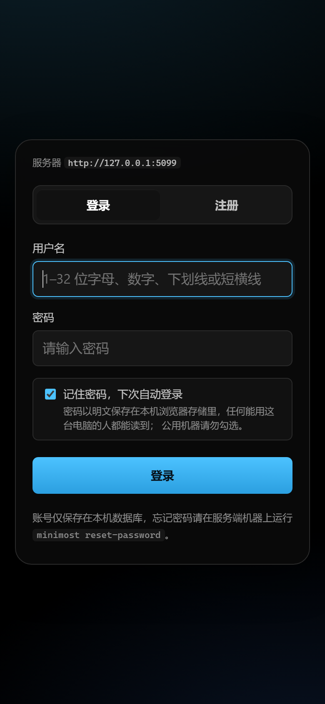
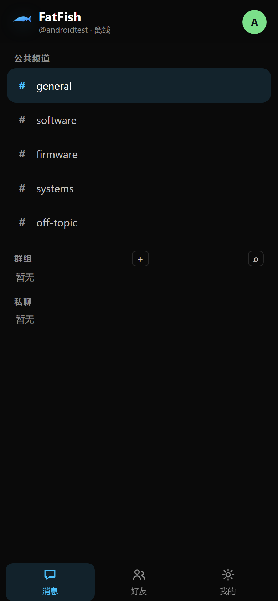
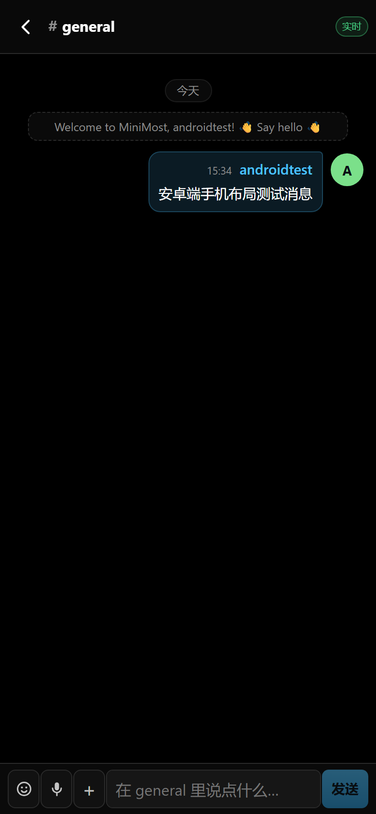

# FatFish 安卓端

FatFish 的 Android 客户端：一个原生 Android 外壳，加上与电脑端**同源**的 React 界面。
它是纯客户端：**不内置 Python 服务端，也不内置 Tailscale**。电脑可以在局域网提供服务，
也可以由电脑端 1.4.1 发布到 tailnet；手机只负责连接。

- **包名**：`com.fatfish.android`
- **版本**：1.2.0（versionCode 6）
- **最低系统**：Android 8.0（API 26），targetSdk 34
- **安装包**：[`dist/FatFish-Android-1.2.0.apk`](dist/FatFish-Android-1.2.0.apk)
- **体积**：约 0.18 MB，无任何 `.so` 原生库
- **界面**：原生连接页 + WebView 中的手机版 FatFish
- **图标**：与电脑软件同款（`desktop/build/icon.png`）


| 登录 | 消息列表 | 聊天 |
| --- | --- | --- |
|  |  |  |

## 1. 它是怎么工作的

```
┌──────────────────────────────┐        HTTP / HTTPS        ┌──────────────────────────────┐
│ Android APK                  │  ───────────────────────▶  │ 电脑上的 FatFish 服务端       │
│ SetupActivity  连接/体检     │  GET /app/health           │ Flask + SQLite + 本地文件     │
│ MainActivity   WebView       │  GET /app/ (React UI)      │ desktop_ui/ 手机响应式界面    │
│ Native Bridge  主题/返回/下载│  GET /events (SSE)         │ 原有 API、SSE、上传、下载     │
└──────────────────────────────┘                            └──────────────────────────────┘
```

- **不内置 Tailscale**：APK 不加载 tsnet，也不申请系统 VPN 权限。跨网络时由手机上的
  官方 Tailscale App 建好系统 VPN，FatFish 只连接一个普通 HTTP(S) 地址。
- **同源 Cookie**：WebView 直接加载 `http(s)://电脑:端口/app/`，会话、CSRF、SSE 与
  浏览器访问一致。
- **数据只在电脑上**：手机不保存聊天数据库。
- **原生只做 WebView 不方便做的事**：连接前体检、自签证书确认、文件选择、麦克风/相机
  权限、下载、系统栏主题、返回键和服务器切换。

> 手机不能单独运行 FatFish 服务端。手机也不能把服务发布到 tailnet；发布端是电脑 1.4.1。

## 2. 局域网连接

先关闭桌面客户端，避免两个进程同时打开同一份 SQLite 数据库。

### 启动服务端

```powershell
cd 安卓端
powershell -ExecutionPolicy Bypass -File .\start-server.ps1
```

脚本会检查 `.venv`，使用和桌面端相同的 `%APPDATA%\FatFish\data`，监听
`0.0.0.0`，并打印当前电脑的局域网 IPv4（会过滤 Radmin/VMware 等虚拟网卡）。

- 默认 HTTPS；加 `-Http` 使用明文 HTTP
- 自定义端口：`-Port 5001`
- 桌面进程仍在运行时脚本会拒绝启动，除非加 `-AllowDesktopRunning`

Windows 防火墙需放行对应 TCP 端口，且只对专用/局域网配置文件放行。不要把端口映射到公网。

### 手机连接

安装 APK，打开后填：

```text
192.168.x.x:5000
```

不写协议时会先试 HTTPS，再试 HTTP；HTTPS 自签证书会单独询问一次，信任按主机记录。
连接成功后进入登录/注册页，账号与电脑端共用。

## 3. 通过 Tailscale 连接（使用系统 Tailscale）

电脑端 1.4.1 可以把 FatFish 发布到 tailnet。手机端从 1.2.0 起**不内置 tsnet**，改用
官方 Tailscale Android App 提供 tailnet 网络；FatFish 只做地址连接。

### 电脑端

1. FatFish 1.4.1 或更新版本 →「设置 → 远程访问（Tailscale）」。
2. 填节点名和端口（默认 80），启动节点，完成 Tailscale 登录。
3. 记下面板显示的地址，例如 `http://100.x.x.x:80/`，或 MagicDNS 名字
   `fatfish.tailc225e5.ts.net`。

### 手机端

1. 安装并登录**官方 Tailscale App**，打开 VPN 开关，确认能看到电脑节点。
2. 打开 FatFish，填写：
   ```text
   fatfish.tailc225e5.ts.net:80
   ```
   或：
   ```text
   http://100.x.x.x:80
   ```
3. 点连接。FatFish 不申请 VPN 权限，也不创建 VPN；tailnet 网络由 Tailscale App 负责。
4. 之后账号、SSE、上传下载都走这个地址。

tailnet ACL 仍然决定手机能不能访问电脑的端口。手机上的 FatFish 不保存 Tailscale
身份或授权密钥。

## 4. 安装 APK

把 [`dist/FatFish-Android-1.2.0.apk`](dist/FatFish-Android-1.2.0.apk) 传到手机，允许
“安装未知应用”后打开。也可以：

```powershell
& .android-toolchain\sdk\platform-tools\adb.exe install -r 安卓端\dist\FatFish-Android-1.2.0.apk
```

首次打开：

1. 局域网填 `192.168.x.x:5000`；Tailscale 填电脑的 tailnet 地址。
2. 点“连接”。应用请求 `/app/health`，确认对端是 FatFish。
3. HTTPS 自签证书会单独确认。
4. 进入登录/注册页；账号与电脑端共用。
5. 在“我的 → 安卓客户端”可切换服务器。

## 5. 功能

- 登录、注册、记住密码、注册后自动登录
- 公共频道、私有频道、群组、私聊
- 文本、图片、任意文件、语音消息；表情与贴纸
- SSE 实时消息、输入提示、未读、在线状态
- 好友搜索、申请/同意/拒绝、私聊入口
- 群组创建、群号加入、成员与角色管理、群设置
- 日间/夜间主题（同步到原生状态栏和导航栏；手机端 420ms 颜色渐变）
- 消息列表顶部太阳/月亮快捷切换（需服务端使用本仓库最新的 `desktop_ui`）
- API 接入令牌、服务端存储空间面板
- 附件下载：Android 10+ 保存到“下载/FatFish”；旧系统授权后保存到公共下载目录，
  拒绝权限则保存到应用专用目录
- Android 返回键：先关弹层/管理页 → 再回消息列表 → 再双击退出；查看图片等网页历史时先退回网页

> 主题按钮和渐变是**电脑服务端提供的网页资源**，不是 APK 内置。若顶部没有新按钮，
> 说明电脑端还在使用旧的 `desktop_ui`；只升级 APK 不会更新网页界面。

## 6. 构建

### 依赖

- JDK 17
- Android SDK Platform 35 与 Build-Tools 35.0.0
- Windows PowerShell 5.1（脚本带 UTF-8 BOM）

**不需要 Go 或 Android NDK**：1.2.0 不再编译/打包任何原生 tsnet 库。

当前工作区工具链在 `.android-toolchain/`（不提交版本库）：

```
.android-toolchain/
  jdk/zulu17.54.21-ca-jdk17.0.13-win_x64/
  sdk/platforms/android-35/
  sdk/build-tools/35.0.0/
```

构建脚本会自动找 `ANDROID_HOME` / `ANDROID_SDK_ROOT` / 本目录的 `.android-toolchain`，
也可以用参数指定：

```powershell
powershell -ExecutionPolicy Bypass -File .\build.ps1 `
  -Sdk "D:\Android\Sdk" `
  -Jdk "C:\Program Files\Java\jdk-17" `
  -VersionName "1.2.1" `
  -VersionCode 7
```

### 生成 APK

```powershell
cd 安卓端
powershell -ExecutionPolicy Bypass -File .\build.ps1
```

产物：

```
dist/FatFish-Android-1.2.0.apk
```

构建脚本会：

- 检测中文路径，必要时在 `%TEMP%\fatfish-android-*` 构建再复制回来；
- 打包 `assets/NOTICE.txt`；
- 运行 `apksigner verify --print-certs` 并打印 SHA-256；
- 自动生成调试签名 `keystore/fatfish-debug.jks`（口令 `fatfish`）。该密钥只适合侧载，
  上架前换自己的密钥并备份。

### 当前 APK 的校验值

```
SHA-256  A41A771F27933CE69EF75EFA9FA27C67BDEFE502504E2238D18F11D7C474E4A8
签名     APK Signature Scheme v2 + v3
证书     CN=FatFish, OU=Android, O=FatFish, L=Local, ST=Local, C=CN
```

### 图标

启动图标、自适应图标和品牌图都来自电脑端同一张
[`desktop/build/icon.png`](../desktop/build/icon.png)。桌面图标变化后运行：

```powershell
.\make-icons.ps1
```

## 7. 源码结构

```
安卓端/
├─ app/
│  ├─ AndroidManifest.xml
│  ├─ assets/NOTICE.txt
│  ├─ java/com/fatfish/android/
│  │  ├─ SetupActivity.java     连接页、健康检查、自签名证书确认
│  │  ├─ MainActivity.java      WebView、文件/语音权限、下载、返回、主题
│  │  ├─ HttpProbe.java         /app/health 探测与 URL 归一化
│  │  ├─ ServerConfig.java      服务器地址与信任主机
│  │  └─ AppInfo.java
│  └─ res/                      主题、布局、桌面同款图标、自适应图标
├─ build.ps1                    无 Gradle 的构建/签名/校验脚本
├─ make-icons.ps1               从电脑端 icon.png 生成所有安卓图标尺寸
├─ start-server.ps1             电脑端局域网启动助手
├─ dist/                        APK
├─ screenshots/                 手机尺寸截图与应用图标
└─ README.md
```

手机布局仍复用电脑端 React 源码：

- [`desktop/src/mobile.css`](../desktop/src/mobile.css)：手机断点、底部导航、聊天输入区
- [`desktop/src/lib/useMediaQuery.ts`](../desktop/src/lib/useMediaQuery.ts)：窄屏检测
- [`desktop/src/App.tsx`](../desktop/src/App.tsx)：列表/内容双屏导航、Android 返回桥接
- [`desktop/src/components/Sidebar.tsx`](../desktop/src/components/Sidebar.tsx)：手机顶部栏和主题按钮
- [`desktop/src/components/ChatPane.tsx`](../desktop/src/components/ChatPane.tsx)：聊天页返回按钮
- [`desktop/src/components/SettingsView.tsx`](../desktop/src/components/SettingsView.tsx)：安卓连接信息

Android 桥接只暴露：

```js
window.fatfishAndroid = {
  isAndroid: true,
  version: "1.2.0",
  getServerUrl: () => "http://192.168.1.20:5000",
  switchServer: () => { /* 打开连接页 */ },
  setSystemTheme: (theme) => { /* "light" | "dark" */ },
  openExternal: (url) => { /* 系统浏览器 */ }
};
```

## 8. 安全与隐私

- APK 只申请网络、麦克风、相机和（旧系统）写入下载目录的权限；没有 VPN、通讯录、
  定位、电话状态或广告 SDK。
- **不内置 Tailscale、不申请系统 VPN**。如果使用 tailnet，由官方 Tailscale App 建立
  VPN；FatFish 只看到一个普通服务器地址。
- HTTP 是明文；局域网可用 HTTPS 自签证书（首次使用时确认并按主机记住）。Tailscale
  模式下，tailnet 本身负责加密。
- 服务端只应监听 `0.0.0.0` 在局域网内使用；不要做公网端口映射。
- “记住密码”密码明文存在 WebView 的 localStorage 中；公用手机不要勾选。
- 卸载 APK 不会删除电脑上的任何消息。
- `android:allowBackup="false"`，避免备份会话 Cookie。

## 9. 已验证与未验证

已在本工作区完成：

- `npx tsc --noEmit`、Vite 生产构建、23 项 React 渲染冒烟全部通过
- APK 1.2.0：versionCode 6、minSdk 26、targetSdk 34、启动 Activity 正确
- APK 内**没有** `lib/` 原生库、没有 `TsnetActivity`、没有 tsnet 类
- v2 + v3 签名校验通过，体积约 0.18 MB
- 连接页仍是原来的 URL 健康检查，WebView 仍加载同源 `/app/`

尚未在这个环境里完成：实体手机上的安装、触控、软键盘、文件选择器、摄像头/麦克风验收
（当前环境没有 Android 设备）。若使用 Tailscale，需先在手机上安装官方 Tailscale App
并完成登录，这一步不属于 FatFish。

## 10. 常见问题

**连接被拒绝 / 超时**

- 服务端是否用 `--host 0.0.0.0`，而不是默认 `127.0.0.1`？
- 手机和电脑是否同一 Wi-Fi/同一 tailnet？
- 防火墙是否放行 TCP 端口？
- 浏览器先访问 `http(s)://地址:端口/app/health`。

**Tailscale 地址填什么**

- 电脑端 1.4.1 Tailscale 面板里的 `http://100.x.x.x:80/`；
- 或 MagicDNS 名 `fatfish.tailc225e5.ts.net:80`；
- 不要填电脑内部的 `127.0.0.1:5100`，也不要填局域网 `192.168.x.x:5000` 到 Tailscale 模式；
- 手机必须先打开官方 Tailscale App 的 VPN，FatFish 才能访问该地址。

**顶部没有主题按钮 / 没有渐变**

电脑服务端还在用旧 `desktop_ui`。用本仓库源码启动，或重新构建/打包服务端；APK 不含网页资源。

**提示“这不是 FatFish 服务端”**

地址指向别的 Web 服务，或版本太旧没有 `/app/health`。

**手机界面还是电脑版两栏**

服务端返回旧 `desktop_ui`，更新服务端即可。
